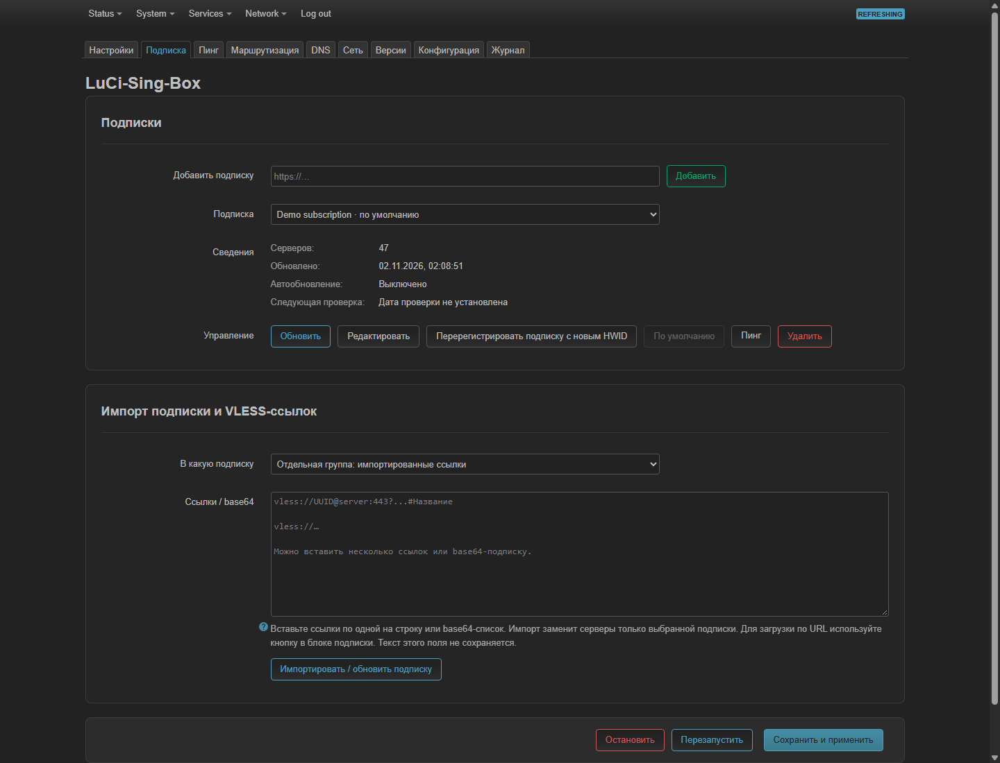
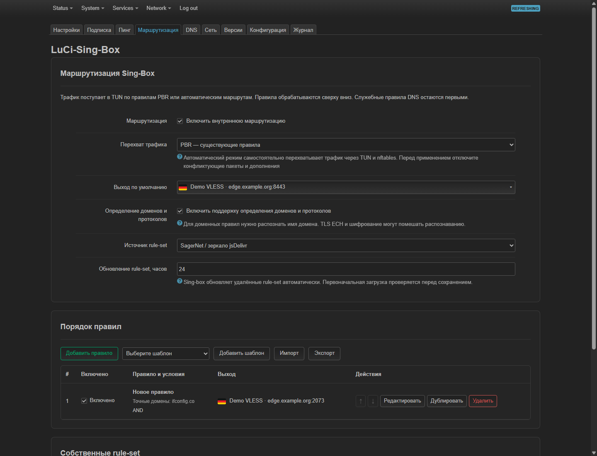
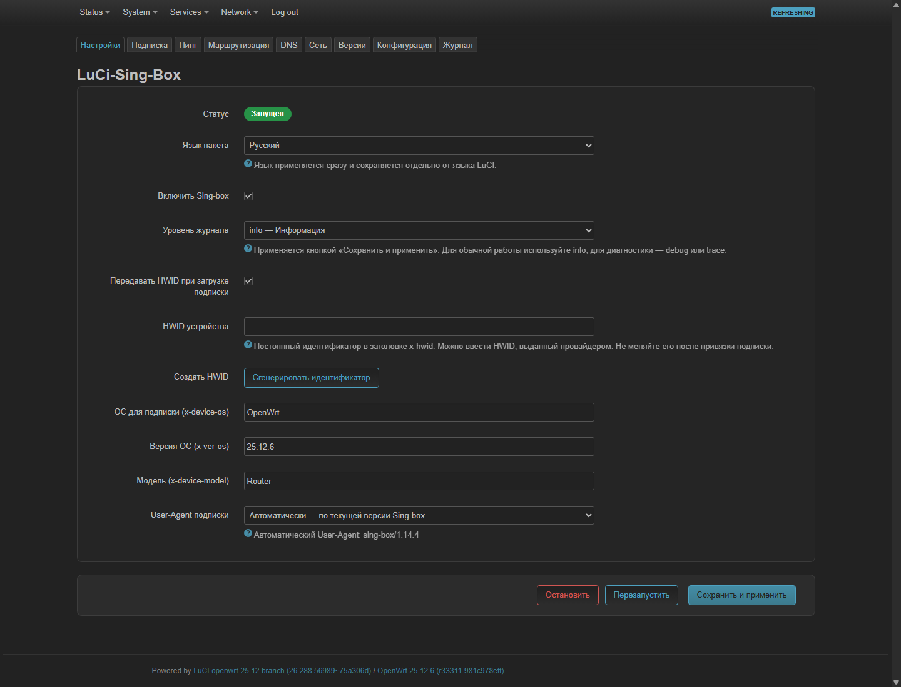
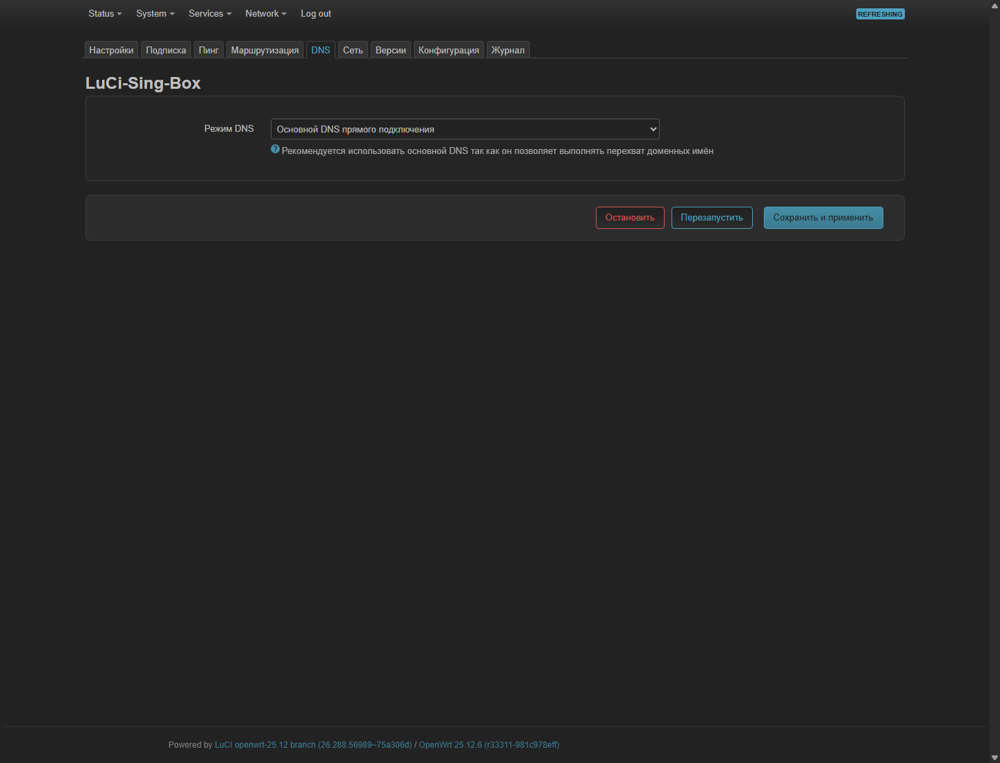
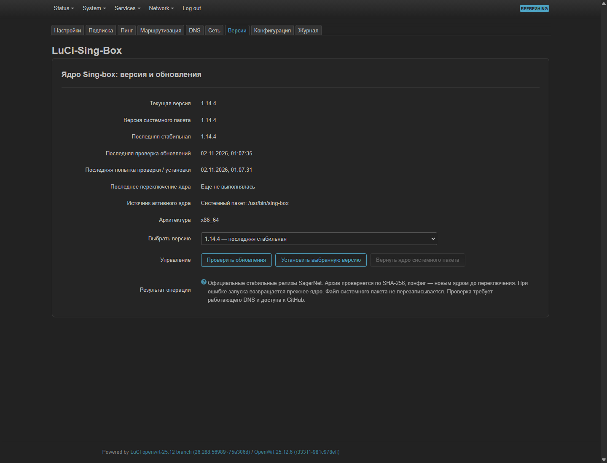

# LuCi-Sing-Box

English | [Русский](README.md)

A Russian/English LuCI application for VLESS subscriptions, HWID, Sing-Box routing and latency tests. Validated on OpenWrt 25.12.6 x86/64 with Sing-Box 1.14.4. Package language is independent of LuCI language.

## Install v0.1.0

Application package: **luci-app-sing-box 0.1.0-r8**, **noarch**. Validated on **OpenWrt 25.12.6 x86/64** and **Sing-Box 1.14.4**. This is an independent project, not an official SagerNet/OpenWrt component. Install the core separately. Other CPU architectures need a compatible core and have not been live-tested.

Back up OpenWrt configuration, install Sing-Box >=1.14.4 and dependencies from trusted sources, download the APK and SHA256SUMS from [Releases](https://github.com/GuardConnect/luci-app-sing-box/releases/tag/v0.1.0), verify the digest and copy the APK to `/tmp`:

```sh
apk update
apk add --allow-untrusted /tmp/luci-app-sing-box-0.1.0-r8.apk
```

This standalone APK is unsigned; `--allow-untrusted` applies to the local install. No package feed is added. If your feeds cannot satisfy `sing-box>=1.14.4`, install a compatible core first; do not bypass dependency checks. Automatic capture needs nftables/firewall4; PBR mode requires separately configured PBR.

Open **Services → Sing-Box**. Reload an existing page without browser cache after upgrading. The service is disabled by default until configured and applied. Remove with `apk del luci-app-sing-box`; review/remove previously created interfaces and firewall policies separately. Back up `/etc/config/singbox_gui` and `/etc/singbox-gui/` before reinstalling.

## Screenshots

Actual LuCI screenshots, with private values replaced by demonstration data before rendering; router settings were not changed.




<details><summary>Settings, DNS and versions</summary>





</details>


## Setup and tabs

1. **Settings:** enable the managed service; choose package language and log level; configure subscription HWID and User-Agent. The automatic User-Agent follows the active core version.
2. **Subscription:** add an HTTPS URL or import VLESS links/base64. Source names are generated from the URL host. Select a source to update, edit, delete, set as default or schedule automatic refresh.
3. **Network:** choose the real uplink, such as `wan (eth0)`, then create the OpenWrt interface and optional firewall rules. The logical interface (`sb0`, for example) and TUN device (`sb-tun0`) are different settings.
4. **Routing:** select specific subscription nodes for individual rules and the default outbound. Server selection exists only here. Lists show names, addresses, ports and locally rendered emoji. Internal routing is enabled by default; the default outbound is **Direct connection**. Unmatched traffic therefore connects directly unless you choose another outbound.
5. Validate/preview, then save and apply. Save routing stores rules without restarting; Save and apply validates and restarts with rollback on failure. Restart uses saved settings; Stop stops and disables the managed service. General Save and apply commits UCI immediately.

**Versions** manages official stable core releases with SHA-256 verification, configuration checks and rollback, without overwriting the system package binary. **Configuration** offers a show/hide JSON editor, validation and a return to GUI-generated configuration. **Log** supports copy, live polling, pause and autoscroll; polling pauses when the browser tab is hidden.

## Routing builder

Ordered rules support exact domains, suffixes, keywords, **Go/RE2 regular expressions**, **geosite**, GeoIP, source/destination IP/CIDR, ports/ranges, network, sniffed protocol, IP version and private addresses. Values in a field use OR; fields can use AND/OR. Inversion, match-all, enable/disable, reorder, duplicate and delete are available.

Outbounds are direct, block or a specific node from any subscription. There is no profile-name field or global Selected server alias. Legacy rule references to that alias migrate to a specific node; the old default alias becomes direct.

Geosite/GeoIP categories use current SagerNet remote `.srs` rule-sets. Legacy geosite/geoip fields are not emitted. GitHub and jsDelivr are available, alongside custom HTTPS binary/source rule-sets. Initial files are checked by the actual core and cached locally; the core updates remote sets periodically (24 hours by default). The remote configuration uses the Sing-Box 1.14+ `http_client` and `initial_path` API.

Presets cover private IPs, advertising geosite and UDP 443. Import/export uses this builder's JSON format, not a full Throne profile. Preview contains the generated route object. In manual JSON mode rules may be saved, but GUI generation must be restored before applying them. Managed DNS rules remain first. Domain/protocol detection is optional; ECH and encryption can prevent domain recognition.

### Traffic capture

- **PBR — existing policies:** automatic routes and redirect are disabled. PBR sends selected traffic into the logical TUN interface, then the builder's rules choose its outbound.
- **Automatic routes — without PBR:** Sing-Box creates IPv4 TUN routes and nftables redirect. Disable PBR before applying; concurrent enabled modes are rejected. Outbounds bind the uplink, conflicting routing marks are removed, and private/service ranges stay excluded. PBR is optional and no longer a source-package dependency.

Automatic startup was verified in an isolated network namespace with the real TUN, policy routes and nftables, without changing the host network. IPv6 capture is not implemented.

## Ping

The former Servers tab is now **Ping**, without a production server picker. Select a subscription, method, DNS resolver and timeout.

- **TCP Connect:** measures a TCP connection to the actual VLESS port, bound to the uplink. It does not validate VLESS authentication.
- **Diagnostics:** independently checks ICMP and the VLESS TCP port.
- **HTTP(S) URL through VLESS:** uses a private loopback core instance pinned to the tested VLESS node. It does not inherit user routes or auto-capture settings and has no direct fallback. Success requires a 2xx/3xx response and valid TLS. The metric is time to first byte. Presets: Google, Cloudflare, Apple; custom URLs are supported.

DNS choices: default dnsmasq/HTTPS DNS Proxy, Cloudflare, Google, Quad9, AdGuard, Yandex, OpenDNS, or a custom IP. This resolver is used for both the node hostname and test URL domain, without changing router DNS.

**Only the button starts measurements.** Opening a tab or changing menus does not start a probe. Cached results are not displayed; new runs and changed settings clear results. Obsolete responses are discarded. The button recovers after success/failure. Stop server latency test cancels the active job and temporary processes, skips remaining servers and preserves displayed results. A new test can start immediately after cancellation is confirmed. Mass testing uses one background job with progressive results: at most 6 TCP/ICMP nodes or 2 URL/VLESS nodes at once, with 250 ms progress polling. TCP/ICMP DNS results are reused only within a run; node latency is measured independently. ICMP uses three echo requests 100 ms apart and their median, checking each response ID and random nonce. Configured TCP/URL timeouts are preserved.

## Subscriptions, HWID and DNS

Up to 20 sources are supported. The default source controls the list opened first, not routing outbounds. Automatic intervals are 0 (off) or 5–10080 minutes; cron checks deadlines every minute. Failed downloads preserve nodes. Active routing dependencies protect nodes from deletion or removal by refresh.

HWID is sent by the subscription downloader in `x-hwid`, not by the VLESS core. OS, OS version, model and User-Agent headers are available. Re-registering a source generates a source-specific HWID and persists it only after successful import. Providers may count it as a new device; the app cannot remove old provider registrations.

Primary DNS forwards Sing-Box and captured TUN queries to `127.0.0.1:53`, then dnsmasq and HTTPS DNS Proxy. The app does not rewrite DHCP or HTTPS DNS Proxy. An unavailable primary DoH does not trigger a hidden fallback. An optional external DNS mode is separate. No provider-specific DNS is bundled.

Import supports text/base64 VLESS TCP, WS, gRPC, HTTP/H2, TLS, Reality and Vision. Sing-Box JSON, Clash YAML, XHTTP and VLESS Encryption are not subscription import formats. Certificates are verified; unsupported entries are skipped with warnings.

## Source and build


The shared UI is `singbox-ui.js`; the builder is `singbox-routing.js`, shared emoji/dropdowns `singbox-choices.js`, backend `root/usr/libexec/singbox-gui`, compiler `singbox_routing.py`. Translation catalogues: `tools/i18n.json`, `i18n-messages.json`, `i18n-routing.json`; regenerate with `python3 tools/build-i18n.py`. The package includes 4009 Twemoji v17.0.3 SVGs (~10 MB uncompressed), MIT/CC-BY 4.0 with licenses. `tools/vendor-emoji.py` reproduces the pinned download. No external CDN is used at runtime.

Settings: `/etc/config/singbox_gui`; sources, routing, HWID and manual JSON: `/etc/singbox-gui/`; transient jobs: `/var/run/singbox-gui/`. The source archive excludes user credentials and subscription secrets. See `VALIDATION.md` for evidence.

Primary references: [TUN](https://sing-box.sagernet.org/configuration/inbound/tun/), [rules](https://sing-box.sagernet.org/configuration/route/rule/), [actions](https://sing-box.sagernet.org/configuration/route/rule_action/), [rule-set](https://sing-box.sagernet.org/configuration/rule-set/), [geosite](https://github.com/SagerNet/sing-geosite). The builder's organization follows [Throne behavior](https://github.com/throneproj/Throne/blob/32ee312fadb615a5f12b2e18a386aa99c86ed03d/include/ui/setting/RouteItem.ui); Throne code was not copied.

## Build / Сборка

See [BUILD.md](docs/BUILD.md) for SDK and standalone APK build instructions. Test evidence: [VALIDATION.md](VALIDATION.md). Release notes: [CHANGELOG.md](CHANGELOG.md).
