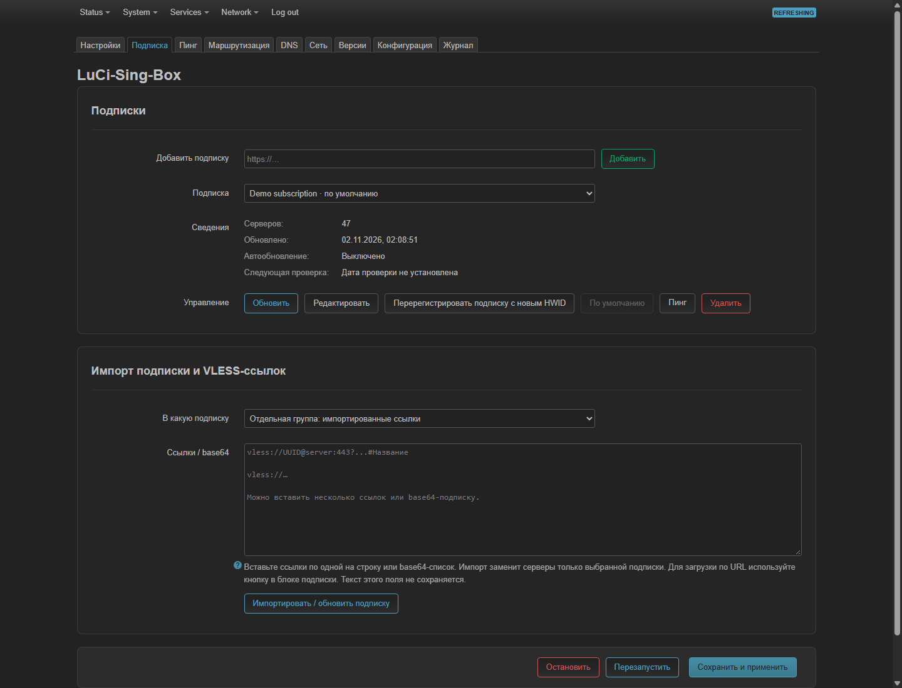
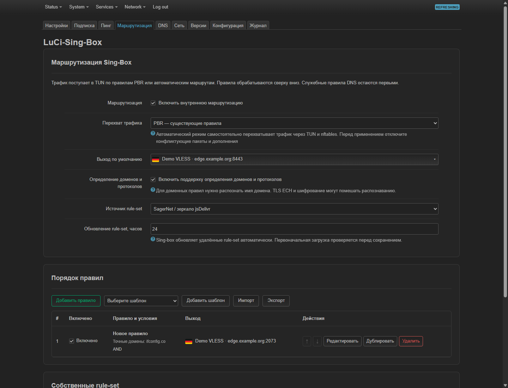
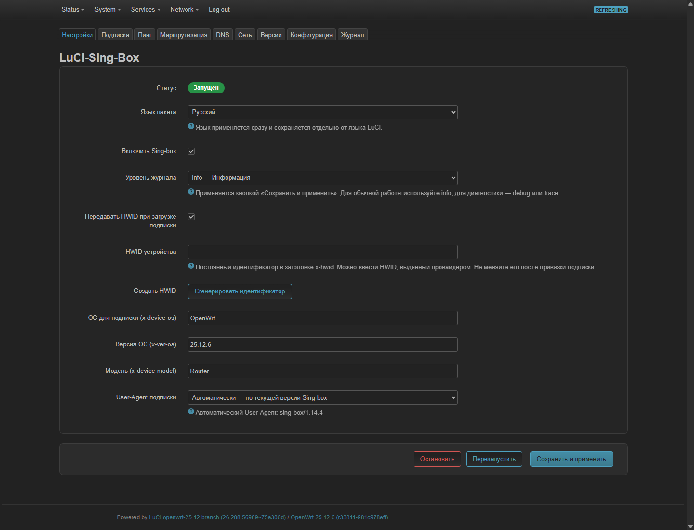
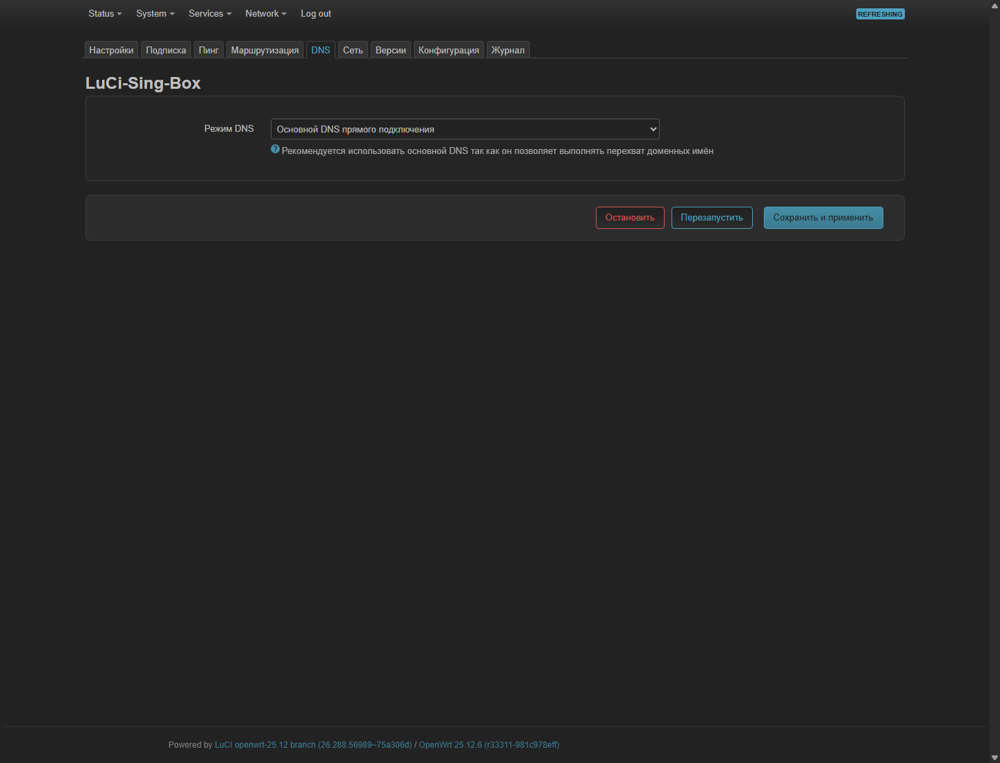
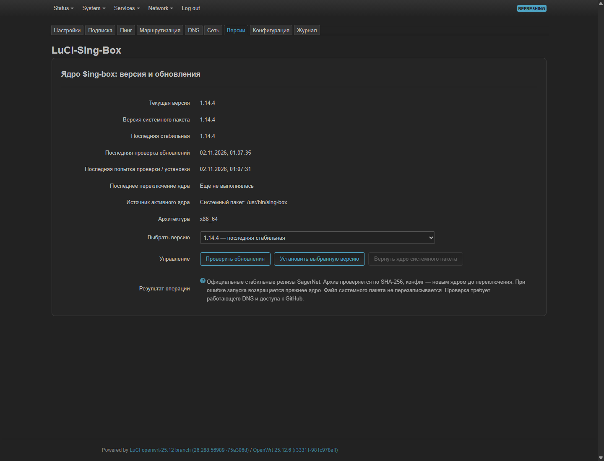

# LuCi-Sing-Box

Русский · [English](README.en.md)

**Управляйте Sing-Box на роутере OpenWrt через удобный веб-интерфейс.** Добавляйте VLESS-подписки, выбирайте серверы, проверяйте задержку и настраивайте, какие сайты должны работать через VPN.

[Скачать пакет](https://github.com/GuardConnect/luci-app-sing-box/releases/latest) · [Сообщить об ошибке](https://github.com/GuardConnect/luci-app-sing-box/issues)

## Что нового в 0.1.1-r3

- Исправлено исчезновение адреса TUN и автоматических маршрутов после применения настроек.
- Исправлена логика правил маршрутизации по образцу Throne для Sing-Box 1.14.4.
- Улучшены проверка запуска и восстановление предыдущего конфига при ошибке применения.
- Устранена блокировка повторной проверки, если процесс проверки не запустился.

Сборка **0.1.1-r3** прошла 63 автоматических теста. На реальном роутере проверены повторное применение, TUN, автоматические маршруты, DHCP, прямой выход через WAN и срабатывание семи правил. Генератор правил также проверен на 100 запросах через ядро 1.14.4. [Подробнее о правилах](docs/ROUTING-SEMANTICS.md).

## Что умеет

- Несколько подписок с автоматическим обновлением.
- Выбор сервера для отдельных сайтов или всего направленного в Sing-Box трафика.
- Маршрутизация через PBR или встроенный автоматический режим.
- Правила по доменам, IP-адресам и категориям сайтов — geosite.
- Проверка задержки и доступности серверов.
- Работа с HTTPS DNS Proxy, настройка DNS и HWID подписки.
- Обновление ядра Sing-Box, просмотр журнала и редактирование конфигурации.
- Русский и английский интерфейс.

## Установка

Проверено на **OpenWrt 25.12.6 x86/64** с **Sing-Box 1.14.4**. Для этой сборки рекомендуется отдельно установленное ядро **Sing-Box 1.14.4**. Более новые версии отдельно не проверялись. Другие архитектуры пока не проверены на реальных устройствах.

1. Сделайте резервную копию настроек роутера.
2. Скачайте `luci-app-sing-box-0.1.1-r3.apk` из [релиза](https://github.com/GuardConnect/luci-app-sing-box/releases/latest) и скопируйте его в `/tmp` роутера.
3. Подключитесь к роутеру по SSH и выполните:

```sh
apk update
apk add --allow-untrusted /tmp/luci-app-sing-box-0.1.1-r3.apk
```

Параметр `--allow-untrusted` нужен, потому что пакет пока не подписан. Если установка сообщает об отсутствии подходящего Sing-Box, сначала установите совместимое ядро.

После установки откройте **Services → Sing-Box** в интерфейсе OpenWrt.

## Первая настройка

1. **Подписка:** вставьте ссылку от провайдера и загрузите серверы.
2. **Сеть:** выберите интерфейс выхода в интернет, например `wan (eth0)`, затем создайте интерфейс Sing-Box и firewall-правила.
3. **Маршрутизация:** выберите способ работы:
   - **С PBR:** укажите созданный интерфейс в нужных правилах PBR.
   - **Без PBR:** отключите PBR и другие конфликтующие средства маршрутизации, затем выберите автоматический режим. Он поддерживает IPv4.
4. Здесь же выберите сервер в поле **«Выход по умолчанию»** или назначьте серверы отдельным правилам. Изначально выбран вариант **«Прямое подключение»** — без VPN.
5. В **«Настройки»** включите Sing-Box и нажмите **«Сохранить и применить»**.

Во вкладке **«Пинг»** можно проверить серверы. Если подключение не работает, откройте **«Журнал»**.

Автоматический режим проверен на OpenWrt 25.12.6 x86/64: DHCP выдаёт адреса, маршруты сохраняются после применения. Полная перезагрузка роутера и другие устройства не проверялись. Срабатывание правила не гарантирует доступность сайта: например, ChatGPT может вернуть HTTP 403 со стороны сервиса.

## Как выглядит

На скриншотах личные данные заменены примерами.



<details>
<summary>Маршрутизация, настройки, DNS и обновления</summary>






</details>

## Подробнее

- [Подробное руководство и ограничения](docs/GUIDE.ru.md)
- [Сборка из исходников](docs/BUILD.md)
- [Что проверено](VALIDATION.md)
- [История изменений](CHANGELOG.md)

Независимый проект, не официальный продукт OpenWrt или SagerNet. Код — MIT, изображения emoji — CC BY 4.0.
